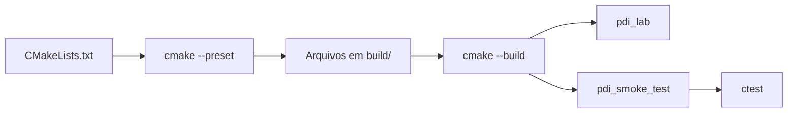
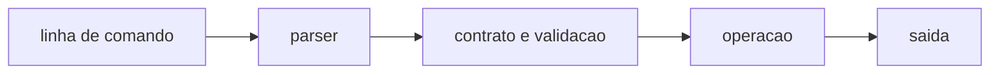

# Laboratorio M2.1

Este projeto implementa a operação `segment` para gerar máscaras binárias de imagens de moedas, comparando dois métodos de limiarização em tons de cinza: limiar fixo (fixed) e limiar automático de Otsu (otsu). A saída é uma imagem PNG de um canal, com o mesmo tamanho da entrada e valores somente 0 (fundo) e 255 (primeiro plano).

## 1. O que cada arquivo de construção faz

### `CMakeLists.txt`

É a descrição principal do projeto para o CMake. Ele informa:

- qual versão mínima do CMake será utilizada;
- qual padrão de C++ será adotado;
- quais arquivos compõem a biblioteca `pdi_core`;
- como localizar o OpenCV;
- como construir o executável `pdi_lab`;
- como construir e registrar os testes públicos.

### `CMakePresets.json`

Contém configurações prontas de construção. Um *preset* evita repetir várias opções do CMake no terminal.

Os presets fornecidos são:

- `ucrt64-debug` — Windows com MSYS2 UCRT64, modo de depuração;
- `ucrt64-release` — Windows com MSYS2 UCRT64, modo otimizado;
- `unix-debug` — Linux/macOS e outros Unix-like, modo de depuração.

O comando `cmake --preset ...` **configura** o projeto. O comando `cmake --build --preset ...` **compila**. O comando `ctest --preset ...` **executa os testes**.



## 2. Windows — MSYS2 UCRT64

Com OpenCV instalado no ambiente:

```bash
cmake --preset ucrt64-debug
cmake --build --preset ucrt64-debug
ctest --preset ucrt64-debug
./build/ucrt64-debug/pdi_lab.exe --help
./build/ucrt64-debug/pdi_lab.exe --version
```

## 3. OpenCV portátil

Em uma máquina sem permissão para instalar OpenCV no sistema, extraia uma distribuição compatível com o mesmo toolchain UCRT64/GCC em uma pasta do usuário e informe o diretório que contém `OpenCVConfig.cmake`:

```bash
export PDI_OPENCV_DIR="$HOME/pdi-tools/opencv/lib/cmake/opencv4"
cmake --preset ucrt64-debug
```

Ou diretamente:

```bash
cmake --preset ucrt64-debug \
  -DPDI_OPENCV_DIR="$HOME/pdi-tools/opencv/lib/cmake/opencv4"
```

Não misture binários C++ compilados para MSVC com o executável GCC/UCRT64 da disciplina.

## 4. Unix-like

```bash
cmake --preset unix-debug
cmake --build --preset unix-debug
ctest --preset unix-debug
./build/unix-debug/pdi_lab --help
```

O mesmo `PDI_OPENCV_DIR` pode apontar para uma instalação local no diretório do usuário.

## 5. Estrutura do código

```text
include/pdi/       interfaces publicas
src/               implementacoes
src/main.cpp       ponto de entrada do executavel
tests/             testes publicos
images/input/      imagens fornecidas e imagens de teste
images/output/     resultados em imagem
kernels/           kernels textuais
results/           CSV, JSON e outros resultados
```

O fluxo principal é:



## 6. Compilar e testar

Na raiz do repositório, configure, compile e execute os testes com o preset Unix:

```bash
cmake --preset unix-debug
cmake --build --preset unix-debug
ctest --preset unix-debug
```

O executável resultante é `build/unix-debug/pdi_lab`.

## 7. Executar a segmentação localmente

Execute os comandos a partir da raiz do repositório. Os caminhos de entrada e saída são relativos a essa pasta; as imagens fornecidas estão em `images/input/` e os resultados ficam em `images/output/`.

Limiar fixo na imagem fácil:

```bash
./build/unix-debug/pdi_lab --operation segment \
  --input images/input/moeda-facil.png \
  --output images/output/fixed-facil.png \
  --method fixed --threshold 240
```

Limiar de Otsu na imagem difícil:

```bash
./build/unix-debug/pdi_lab --operation segment \
  --input images/input/moeda-dificil.png \
  --output images/output/otsu-dificil.png \
  --method otsu
```

## 8. Parâmetros da operação

| Parâmetro | Uso |
|---|---|
| `--operation segment` | Seleciona a operação de segmentação. |
| `--input <arquivo>` | Imagem de entrada de 8 bits por canal, com 1, 3 ou 4 canais. |
| `--output <arquivo>` | Caminho do arquivo da máscara. Prefira PNG, que não introduz perdas. |
| `--method fixed` | Aplica limiar fixo em uma versão em tons de cinza da imagem. Exige `--threshold`. |
| `--method otsu` | Calcula automaticamente o limiar pelo histograma em tons de cinza. Não use `--threshold`. |
| `--threshold <0..255>` | Limiar inteiro obrigatório para `fixed`; aceito entre 0 e 255. |
| `--invert true\|false` | Inverte a seleção do primeiro plano. O padrão é `false`. |

## 9. Imagens e resultados

- `images/input/moeda-facil.png`: moedas em condições favoráveis;
- `images/input/moeda-dificil.png`: moedas em uma cena com variação de fundo e iluminação;
- `images/output/`: destino das máscaras geradas.

Compare a imagem original e as máscaras produzidas pelos dois métodos.
Observe falsos positivos (fundo incluído) e falsos negativos (partes das moedas omitidas) para decidir qual configuração é mais adequada. Os comandos e as observações dos resultados deste experimento também estão registrados em [`REPORT.md`](REPORT.md).
